# Awesome Endpoint Detection and Response (EDR) 🛡️⚡

  

  
  
  
  
  
  
  

---

## 📌 Executive Summary & Introduction

Welcome to the definitive **Awesome Endpoint Detection and Response (EDR)** collection — a curated directory of market-leading **SaaS platforms**, enterprise extended detection & response (**XDR**) frameworks, and production-tested **open-source security projects**. 

Designed for **Security Operations Center (SOC) teams, DFIR specialists, detection engineers, and security architects**, this guide focuses on:
- 🔍 **Real-time Runtime Telemetry** (ETW, eBPF, auditd, audit logs)
- 🧠 **Behavioral Analytics & Anomaly Detection** (MITRE ATT&CK® mapping, LOLBAS activity)
- 🚨 **Automated Incident Response & Remediation** (Host isolation, process kill, ransomware rollback)
- 🛠️ **Self-Hosted, Transparent Security Architectures** for complete data privacy

---

## 📑 Table of Contents

- [📊 Sector Overview & Market Dynamics](#-sector-overview--market-dynamics)
- [☁️ SaaS / Hosted Platforms](#️-saas--hosted-platforms)
- [🔓 Open-Source GitHub Projects](#-open-source-github-projects)
  - [🔥 Primary Open-Source Platforms](#-primary-open-source-platforms)
  - [🧪 Emerging, Niche & Framework Projects](#-emerging-niche--framework-projects)
- [🤝 How to Contribute](#-how-to-contribute)
- [💖 Support](#-support)
- [📈 Star History](#-star-history)
- [⚠️ Disclaimer](#️-disclaimer)

---

## 📊 Sector Overview & Market Dynamics

The global Endpoint Detection and Response (EDR) market is currently valued between **$5.1B and $7.2B**, forecasted to surge past **$18B to $45B+** by the early 2030s at an estimated **22%–26% CAGR**. The sector exhibits a distinct two-tier market structure:

- **Moderately Concentrated at the Platform Tier**: An established oligopoly of cybersecurity heavyweights—including Microsoft, CrowdStrike, SentinelOne, and Palo Alto Networks—dominates enterprise budgets through platform consolidation across endpoint security, cloud security posture, identity protection (ITDR), and native SIEM ingestion.
- **Fragmented in Implementation & Services**: The broader delivery ecosystem remains highly fragmented across hundreds of localized Managed Detection and Response (MDR) providers, niche compliance tools, and specialized digital forensics and incident response (DFIR) toolkits tailored for SMBs and sovereign privacy requirements.

---

## ☁️ SaaS / Hosted Platforms

| Product | Company Valuation / Revenue | Starting Pricing | Free Tier / Trial Limits | Description & Key Trade-offs |
| :--- | :--- | :--- | :--- | :--- |
| **Microsoft Defender for Endpoint** | **~$3.8T Market Cap** / ~$281.7B FY25 Revenue | **$3.00/user/month** (Plan 1 standalone, annual commit; Plan 2 at $5.20/user/month; up to 5 concurrent devices/user) | **30-day free trial** (up to 25 test licenses across Windows, macOS, Linux with full Plan 2 EDR/AIR features) | Cloud-native EDR integrated natively into Microsoft 365 and Defender XDR. Excellent integration; trade-off is Microsoft ecosystem lock-in and varying cross-OS telemetry parity. |
| **Carbon Black EDR** (Broadcom) | **~$1.3T Market Cap** / ~$63.9B FY25 Revenue | **~$50.00/endpoint/year** (baseline list through authorized enterprise partners; ~$4.15/endpoint/month) | **14 to 30-day proof-of-concept (POC)** (custom provisioned evaluation via partner/sales rep; no automated self-service free tier) | Enterprise behavioral detection and continuous monitoring. Best for Broadcom ecosystem users; trade-off is licensing model complexity post-VMware transition. |
| **Palo Alto Cortex XDR** | **~$120B Market Cap** / ~$9.2B FY25 Revenue | **~$7.00/endpoint/month** (baseline Cortex XDR Prevent/Pro software licensing via certified partner quote) | **14 to 30-day proof-of-concept (POC)** (gated evaluation coordinated via sales engineering; no automated instant free trial) | Extended detection and response marrying endpoint telemetry with network firewalls and cloud events. Trade-off is heavy reliance on Palo Alto infrastructure investment. |
| **CrowdStrike Falcon Insight** | **~$80B Market Cap** / ~$3.95B FY25 Revenue | **$59.99/device/year** (~$4.99/month for Falcon Go entry tier; Falcon Pro starts at ~$95.00/device/year) | **15-day free trial** (Falcon Prevents/Go features on up to 100 endpoints, zero credit card required; no permanent free tier) | Cloud-native EDR with Threat Graph and lightweight kernel agent. Industry-leading intelligence; trade-off is premium pricing and enterprise contract minimums. |
| **SentinelOne Singularity Complete** | **~$6.5B Market Cap** / ~$800M Revenue | **$69.99/endpoint/year** (Singularity Core AV; full Singularity Complete EDR starts at ~$179.99/endpoint/year) | **14 to 30-day proof-of-concept (POC)** (partner/sales-assisted trial with full automated remediation; no instant self-service free tier) | Autonomous AI-driven EDR with Storyline tracking and one-click rollback. Trade-off is local agent resource footprint during high-volume process scanning. |
| **Trend Micro Vision One** | **~$6.0B Market Cap** / ~$1.7B Revenue | **~$25.00/endpoint/year** (core endpoint security/EDR subscription component pricing; ~$2.08/month) | **30-day free trial** (unlimited access to Vision One console and threat hunting modules during evaluation window) | Broad detection across endpoints, email, and cloud workloads. Best for all-in-one vendor environments; trade-off is suite complexity. |
| **Sophos EDR** (Intercept X) | **~$3.9B Enterprise Value** / ~$1.2B Revenue | **~$35.00/user/year** (Intercept X Advanced starting price through authorized MSP partners; ~$2.90/user/month) | **30-day free trial** (fully functional Sophos Central evaluation with unlimited device onboarding during trial) | EDR combined with deep learning anti-exploit tech and optional 24/7 MDR. Trade-off is centralized policy management overhead for large enterprise setups. |
| **Huntress** | **$1.55B Valuation** / ~$150M+ Revenue ($250M ARR run-rate) | **$8.00/endpoint/month** (annual agreement; ~$96.00/endpoint/year with bundled 24/7 human SOC) | **14-day free trial** (unlimited endpoint agents deployed with active human threat-hunting and remediation support) | Managed EDR tailored for SMBs and MSPs with human-backed investigation and isolation. Trade-off is less direct low-level detection rule customization. |
| **Trellix EDR** | **~$1.05B Revenue** (PE-backed STG/Advent) | **~$45.00/endpoint/year** (baseline Endpoint Security / EDR license via partner quote) | **60-day free trial** (official Endpoint Security ePO evaluation provisioned for up to 5 trial nodes via sales) | Enterprise EDR integrating threat intelligence from legacy FireEye and McAfee engines. Trade-off is legacy console migration complexity. |
| **Cybereason** | **~$850M Valuation** (Acquired by LevelBlue) / ~$180M Revenue | **~$40.00/endpoint/year** (entry enterprise tier via authorized distribution quote; ~$3.33/endpoint/month) | **14 to 30-day proof-of-concept (POC)** (custom enterprise evaluation environment provisioned via sales rep) | AI-guided MalOp cross-machine correlation and MITRE ATT&CK visibility. Trade-off is enterprise pricing floor and implementation overhead. |

---

## 🔓 Open-Source GitHub Projects

Open-source endpoint security tools empower organizations to retain full ownership of telemetry data, avoid vendor lock-in, and inspect detection logic. The repositories below are sorted in **descending order by GitHub star count**.

### 🔥 Primary Open-Source Platforms

1. **[osquery](https://github.com/osquery/osquery)** 
   - **SQL-Powered Operating System Instrumentation, Monitoring, and Analytics (Apache 2.0)**
   - **Highlights**: Exposes an entire operating system as a high-performance relational database. Query processes, open network sockets, kernel modules, file integrity (FIM), and scheduled tasks with standard SQL statements.
   - **Tech Stack**: C++, CMake, SQLite engine. Supports Linux, macOS, Windows, and FreeBSD.
   - **Best For**: Real-time cross-platform host interrogation, telemetry collection pipelines, and compliance verification.

2. **[Wazuh](https://github.com/wazuh/wazuh)** 
   - **Unified Open Source SIEM, XDR & Security Monitoring Platform (GPLv2)**
   - **Highlights**: The most deployed open-source endpoint security solution. Features host intrusion detection (HIDS), file integrity monitoring (FIM), vulnerability assessment, automated active responses (firewall dropping, host isolation, account locking), and deep MITRE ATT&CK mapping.
   - **Tech Stack**: C, Python, OpenSearch indexing backend.
   - **Best For**: Centralized SOC visibility, regulatory compliance (PCI DSS, HIPAA, NIST, CIS benchmarks), and log-based threat mitigation.

3. **[Atomic Red Team](https://github.com/redcanaryco/atomic-red-team)** 
   - **Library of Simple, Portable Open-Source Tests Mapped to MITRE ATT&CK (MIT)**
   - **Highlights**: Essential companion tool for verifying and benchmarking EDR capabilities. Provides scripted atomic tests to simulate adversary techniques and evaluate whether your EDR agents reliably log and alert on adversarial activity.
   - **Tech Stack**: YAML, PowerShell, Bash, Python.
   - **Best For**: EDR alert validation, detection regression testing, and security posture validation.

4. **[Sigma](https://github.com/SigmaHQ/sigma)** 
   - **Generic Signature Format for SIEM and EDR Detection Systems (DRL License)**
   - **Highlights**: The standard open detection format. Write rules once and automatically translate them into queries for Wazuh, Splunk, Elastic, Microsoft Sentinel, and Velociraptor.
   - **Tech Stack**: YAML, Python (`pySigma`).
   - **Best For**: Portable detection engineering and cross-platform rule management.

5. **[Fleet](https://github.com/fleetdm/fleet)** 
   - **Open-Source Endpoint Management & Osquery Fleet Manager (MIT / Core)**
   - **Highlights**: Lightweight, scalable central control server for managing thousands of Osquery and Orbit agents across enterprise desktop and server environments.
   - **Tech Stack**: Go, Vue.js, MySQL, Redis.
   - **Best For**: Real-time fleet-wide host visibility, scheduled live query automation, and IT/security cross-collaboration.

6. **[GRR Rapid Response](https://github.com/google/grr)** 
   - **Enterprise Remote Digital Forensics and Incident Response Framework (Apache 2.0)**
   - **Highlights**: Created by Google to conduct scalable incident triage. Facilitates deep endpoint volatile memory analysis, remote raw disk access, file extraction, and automated forensic timelines.
   - **Tech Stack**: Python, Protocol Buffers.
   - **Best For**: Incident response teams requiring deep forensic collection across large distributed fleets.

7. **[OSSEC HIDS](https://github.com/ossec/ossec-hids)** 
   - **Pioneering Host-Based Intrusion Detection System (GPLv2)**
   - **Highlights**: Foundational engine that originally powered Wazuh. Offers signature-based log analysis, rootkit detection, active firewall responses, and lightweight integrity checking.
   - **Tech Stack**: C.
   - **Best For**: Minimalist servers, legacy operating systems, and resource-constrained environments.

8. **[Velociraptor](https://github.com/velocidex/velociraptor)** 
   - **Advanced Digital Forensics and Threat Hunting Platform (Apache 2.0)**
   - **Highlights**: Industry powerhouse for DFIR. Uses VQL (Velociraptor Query Language) to execute complex, multi-threaded investigations and live memory/file artifact hunts across tens of thousands of endpoints in minutes.
   - **Tech Stack**: Go.
   - **Best For**: Proactive threat hunting, triage automation, and rapid incident response investigations.

9. **[OpenEDR](https://github.com/ComodoSecurity/openedr)** 
   - **Full-Featured Open-Source Endpoint Detection & Response Engine (Open Source)**
   - **Highlights**: Open-sourced by Xcitium/Comodo. Incorporates native kernel drivers and user-mode services for process tracking, file/network interception, memory inspection, and MITRE ATT&CK correlation.
   - **Tech Stack**: C, C++.
   - **Best For**: Teams and researchers seeking a genuine low-level, kernel-interfacing EDR agent codebase.

---

### 🧪 Emerging, Niche & Framework Projects

10. **[Rustinel](https://github.com/Karib0u/rustinel)** 
    - **Cross-Platform Telemetry & Detection Engine in Rust**
    - Collects Windows ETW and Linux eBPF telemetry without kernel drivers. Evaluates Sigma rules and YARA signatures in user space with ECS-compliant NDJSON alert outputs.

11. **[Vettaiyan](https://github.com/m0n1x90/vettaiyan)** 
    - **Enterprise-Grade Open-Source Windows EDR Engine in C/C++**
    - Utilizes Windows kernel callbacks (PsSetCreateProcessNotifyRoutineEx, ObRegisterCallbacks, Registry callbacks) for process, thread, and registry tampering detection alongside YARA memory scanning.

12. **[Warden](https://github.com/Spellskite-coding/Warden)** 
    - **Security-First Linux Workstation EDR (Rust)**
    - Designed specifically for Linux endpoints with automated quarantine, ransomware behavioral detection, YARA integration, and strict privilege elevation controls.

---

## 🤝 How to Contribute

We welcome contributions, corrections, and additions from the cybersecurity community! 🚀

1. 🍴 **Fork the Repository** on GitHub.
2. 🌿 **Create a Feature Branch** (`git checkout -b feature/new-edr-entry`).
3. ✍️ **Add or Update Entries**:
   - Ensure software entries follow the tabular/bullet schema.
   - Include factual pricing, free trial specifications, and accurate technical details.
   - For open-source tools, include the repository URL, star badge, license, and primary use case.
4. 📬 **Submit a Pull Request** with a concise description of your changes.

---

## 💖 Support

If you find this curated EDR directory helpful for your security operations, threat hunting, or research:
- ⭐ **Star this repository** to show your support and help others discover it!
- 🍴 **Fork & Share** it with your SOC team, colleagues, and cybersecurity network.
- ☕ **Buy a Coffee / Sponsor**: Support continued open-source cybersecurity curation via the [GitHub Sponsors Dashboard](https://github.com/sponsors/ishandutta2007).

---

## 📈 Star History

---

## ⚠️ Disclaimer

- This repository is a **community-curated guide** intended for informational and architectural evaluation purposes only. No direct vendor endorsement is implied.
- Deploying endpoint sensors involves high-privilege system hooks and continuous kernel/audit event collection. Always test telemetry agents in sandbox environments and verify compliance with regional data privacy laws (GDPR, CCPA, HIPAA) before rolling out agents in production.
- **Prevention vs. Detection vs. Hunting**: Commercial tools (CrowdStrike, SentinelOne, Microsoft Defender, Cortex XDR) excel at inline pre-execution and kernel-level prevention. Open-source solutions (Wazuh, Osquery, Velociraptor) deliver transparent, vendor-independent detection, post-incident triage, and forensics at scale. Align your choice with your organizational security maturity.
